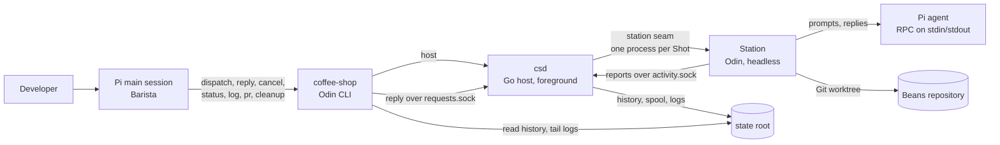

# Coffee Shop Architecture

Coffee Shop is a local, foreground control loop around a developer's main-agent session. Pi is
the first **Barista**: it receives raw user input, decides the work, and sends structured
requests. Coffee Shop runs each unit of work — a **Shot** — as an interactive agent **Station**
in its own Git worktree, and relays that Station's reports and questions back to the Barista.
Oreo may take either agent role once stable; Oreo and Rachel are optional, never prerequisites.

## Who does what

Orchestration is Go. The work is Odin.

| Half | Owns |
| --- | --- |
| **`csd`** (Go host) | The foreground loop, the request and activity sockets, dispatch acceptance, the queue and Slot accounting, Station spawn and watch, the bounded per-Shot log, the report relay, the durable spool, per-request history, the progress ledger, cancel escalation |
| **`coffee-shop`** (Odin CLI) | The commands a person or the Barista runs, the Station and its agent relay, the seams the host drives, Git worktrees, `pr`, `cleanup`, `blend` |

The seam between them is a command line, not a link: `prepare`, `release`, `blend` and `station`
are ordinary subcommands whose output is data. Orchestrating one Shot costs one process per
call, and the two halves share no memory.

## Processes



A Station is a plain child process: no terminal, pane, tab or multiplexer is involved, so the
same design runs on macOS and WSL2.

## A request's life

1. The Barista writes one JSON request per line to the host's stdin. The host acknowledges it
   with `received`, then acts.
2. A `dispatch` request is validated in full before any work starts: an absolute repository
   path, at least one Shot, unique safe ids, prompts, and the optional `model`, `thinking`,
   `kind`, `taste`+`message`, `interactive` and `codemode` fields.
3. For each Shot the host acquires a Slot, then calls the `prepare` seam to create the worktree
   and write the prompt, and starts the `station` seam in that worktree.
4. The Station reports each turn over the activity socket. The host records the report in
   `<state>/host/<request>/history.ndjson`, then announces it on stdout with an `at` stamp.
5. A terminal report — `pulled`, `taste_failed`, `incomplete` or `session_failed` — frees the
   Shot's Slot and starts whatever was queued behind it. A Station that exits without one frees
   its Slot on exit instead.
6. The Barista reads the event stream. `status --stations`, `log` and `reply` are the controls
   it and the developer use while a run is live.

## Host internals

### Slots and the queue

Five Shots run at once. Beyond that a Shot is queued, which the host announces as
`dispatch_queued`, and it starts with `dispatch_dequeued` when a Slot frees. The budget is also
machine-wide: a host takes numbered lock files under `<state>/machine-limit/`, so two hosts
cannot exceed it together.

### Reports, history and the spool

- A Station sends one JSON line per report on `<state>/host/activity.sock`: `brew_id`, `shot_id`,
  `kind`, `description`, `timestamp_ns`.
- A report longer than the activity limit is written to `<state>/host/reports/` and the socket
  carries `file:<path>` instead, which the host reads in full.
- Every report is copied to `<state>/host/spool/` before it is announced, and the copy is removed
  only after it has been relayed. A host that dies mid-announce leaves the copy behind; the next
  host on that state root replays it before accepting new reports.

### Progress supervision

The host keeps a ledger of live Stations, rebuilt from history at start. It raises two events:

- `needs_input_alert` when a Station reports `needs_input`, naming the Station and the session
  key a reply must use. One question produces one alert.
- `stale_warning` after ten minutes without any report. It is a warning, never a cancel, and any
  report restarts the quiet period.

A released Station can neither warn nor alert again.

### Cancellation

`cancel` asks the host to stop one Shot, or every Shot of a request. The host sends `SIGTERM` to
the Station's process group, and escalates to `SIGKILL` after two seconds if the Station is still
there. The Station's own handler closes the agent's input, so the agent exits on its own instead
of dying when the pipes go away.

### Sockets and the lock

| Path | Purpose |
| --- | --- |
| `<state>/host/host.lock` | Held for the host's life, so "a host is running" is a kernel fact |
| `<state>/host/activity.sock` | Station reports |
| `<state>/host/requests.sock` | `coffee-shop reply`, 0600 in a 0700 directory |

### State layout

```
<state>/host/
  host.lock  activity.sock  requests.sock
  bin/            the extracted csd
  extensions/     the installed Pi extension
  spool/          reports not yet relayed
  reports/        full text of over-long reports
  <request>/
    history.ndjson   every event the host emitted for this request
    prompts/<shot>.md
    logs/<shot>.log  bounded, rotated once
    stations/<shot>/ the Shot's Git worktree
```

`history.ndjson` is what `status --stations` reads: a Station that has said nothing looks idle
until its `stale_warning` fires.

## The Station

`coffee-shop station --report <socket> --station <id> --brew <request> --prompt-file <path> --
<agent argv>` runs one Shot.

1. It starts the agent and speaks the Pi RPC subset on its stdin/stdout: a `prompt` in, an
   `agent_end` out.
2. It reports `turn_done` per turn, `usage` when Pi answers `get_session_stats`, and
   `agent_exited` when the agent goes.
3. Replies arrive as lines on its stdin. `coffee-shop reply` sends one through the host's request
   socket; typing into the Station's own stdin does the same.
4. A research Shot and a Pull are one turn: after the first `agent_end` the Station closes the
   agent's input so its post-exit checks run — the research cleanliness check, or the Taste and
   optional commit. `--interactive` keeps the session open instead.
5. A dialog from the `coffee_shop_ask` extension reaches the Barista as `needs_input`; the
   Station keeps it until a reply arrives.

6. `--watch <command>` runs a checker beside the agent and reports each distinct stdout line
   as `rachel_verdict`, so a Station can surface a watcher's verdict without the agent spending a
   call on it. Equal consecutive lines are dropped, and a line is capped at 400 bytes. The
   command should exit when its stdin closes (`watchexec --exit-on-eof` does); the Station closes
   it, then signals the immediate child, matching the agent's own shortcut.

The Station is harness-neutral: it starts whatever argv it is given, so Oreo can take the same
role when it speaks the same RPC subset.

## Git worktrees

Each Shot gets a worktree at `<state>/host/<request>/stations/<shot>` on branch
`cs-host-<request>-<shot>`, created by the `prepare` seam from the Beans' `HEAD`. Uncommitted
changes in the Beans are invisible to a Station, so commit first. The `release` seam removes a
worktree and leaves its branch.

A Pull commits only after its Taste passes, and reports the short hash as `pulled`. A Taste that
cannot run or exits non-zero reports `taste_failed` and leaves the worktree unchanged.

## Blend

`blend` combines 2 to 20 Pull commits into one commit on a new branch, in a temporary worktree
under the state root. It cherry-picks, commits, removes the worktree and keeps the branch. A
conflict or a failed commit removes the worktree *and* the branch, so nothing half-finished is
left behind. It never pushes.

The host drives it through the `blend` seam: the request goes to a file, the seam prints its
events, and the host relays and records them.

## Integration

`pr <run-id> <shot-id> --branch <name>` verifies from history that the Shot passed Taste and
recorded a commit, fast-forwards the developer's branch to it, pushes, and opens a PR with `gh`.
`--blend --message <text>` combines a multi-Pull run first. `cleanup <run-id>` removes that run's
worktrees and keeps every branch. Both are explicit, human-run commands: Coffee Shop never merges
or publishes on its own.

## Safety boundaries

- A Station sees only its own worktree; it never shares one with another Shot.
- Prompt and reply text travel as data: the host builds an argv for the `station` seam, and a
  Blend request travels in a file. Task text never enters shell syntax.
- A failed Station is reported as `session_failed` or `incomplete`; an unreadable record is never
  read as success.
- The host holds one lock, so two hosts cannot serve the same state root, and the machine-wide
  Slot files bound every host together.
- Nothing is deleted automatically: Station worktrees, branches and state accumulate until `pr`
  or `cleanup` removes them.
- A detached daemon, remote execution, unrelated agent or session backends, automatic merge and
  publishing remain out of scope.

## Target boundaries

One machine, a user-facing main-agent/Barista session (Pi first), and one foreground host. Pi is
required for the first usable path. Oreo may take the main or worker role once the Pi-based flow
is usable and Oreo is stable; Rachel is a developer aid outside the runtime. Task decomposition
stays with the Barista and integration decisions with the developer.

## Retired designs

Earlier releases built a one-shot `brew`/Worker pipeline: a per-Brew supervisor, Herdr workspaces
and tabs, a Recipe file format, a Register/Receipt state server, a Filter and a Tray. All of it is
gone from the runtime — the Recipe file input in #172, the pane layer in #174, the Odin host in
#176. `PLAN.md` keeps the record of those releases and the reasons behind each decision.
