# Oreo Architecture

**Why Oreo exists.** pi is very capable, but it's too heavy for parallel jobs. So we want to fire up light-weight oreo to do what pi does. Oreo runs light-weight agents that do what pi does, in parallel. It is a pi extension and uses pi's runtime and login.

Oreo is a small, standalone Odin agent harness. It starts as its own package in this repository and should be extractable into an independent repository. Its first delivery is a pi extension; a library API for Coffee Shop comes later (see [second-round decisions](#decisions-2026-10-10-second-round), item 1).

Since 2026-10-10, Oreo ships as a pi extension and depends on the pi runtime. The agent loop stays in Odin. A thin pi extension bridges the Odin host to pi's model layer, so provider credentials and login stay inside pi (pi's responsibility; proposed, pending the spike). Login and token handling are pi's responsibility; model calls go through pi's model layer (fourth round, F2). Oreo keeps its provider-neutral structure internally (see [second-round decisions](#decisions-2026-10-10-second-round) and [Runtime decision](#runtime-decision-2026-10-10)).

Earlier design, superseded where it conflicts: Pi was a behavioral reference only, and Oreo called provider-owned endpoints directly without hosting a public OAuth service. Pi reference sources are listed in [Oreo's README](README.md#reference-implementation).

## Runtime decision (2026-10-10)

The developer made this decision on 2026-10-10. Items 1–4 supersede earlier text where they conflict. Superseded sections are marked where they appear; their source facts are kept.

1. **Pi runtime.** Oreo ships as a pi extension and accepts a pi runtime dependency. This supersedes the requirement "no Pi runtime dependency" and the "provider-neutral core" wording in [PLAN.md](PLAN.md), and the matching text here and in [README.md](README.md). Keep the provider-neutral structure inside Oreo; all provider access goes through pi's model layer, and login and tokens are pi's responsibility. Superseded by the second-round decisions: the agent loop stays in Odin (item 2).
2. **Login through pi.** Each user logs in through pi with their own account. Oreo does not implement its own OAuth flow and does not register its own client ID, so it makes no direct provider calls. Login, token handling, and client registration are pi's responsibility (fourth round, F2). This supersedes the Oreo-owned provider flows under [Providers and authentication](#providers-and-authentication), including `~/.oreo/auth.json` as the login store. Not yet specified: how work and personal accounts stay separate in pi's auth layer. Resolved by second-round item 6: both accounts are authorized in pi.
3. **GitHub OAuth App dropped.** The "Oreo" OAuth App registration is dropped, and the callback URL suggestion `http://127.0.0.1/callback` is no longer needed. This supersedes the [GitHub Copilot app plan](#github-copilot-app-plan).
4. **Personal import superseded.** No import is needed, because each user logs in through pi. This supersedes the [personal import exception](#personal-import-exception). That section is kept as the record of the earlier decision.
5. **Open items:**
   - **Provider terms (not verified).** Whether an extension of pi falls under pi's provider registration. Personal use is not affected. Second round, item 3: accepted by developer, not verified. Superseded (fourth round, F1): no legal or provider-terms check (developer decision, 2026-10-10: Oreo is a pi plugin).
   - **Resource spike.** Measure how many `createAgentSession` sessions fit in one pi process, and whether they reuse one login. Measure memory and CPU before the plan depends on it.
   - **Delivery.** The earlier answer, "both executable and library", must be revisited. These docs do not record that answer; they describe a library first, with no executable. pi's SDK is a Node/TypeScript API, so an Odin library would need a bridge to call it. Superseded: second-round item 1 chooses the pi extension for now; library and executable delivery are later.

## Decisions (2026-10-10, second round)

The developer made these decisions on 2026-10-10, after the [runtime decision](#runtime-decision-2026-10-10). Items 1–6 supersede earlier text where they conflict. Superseded statements are marked where they appear; their source facts are kept.

1. **Delivery.** Oreo ships as a pi extension for now. Library and executable delivery are later. This answers the delivery open item in the runtime decision. Coffee Shop's library consumption therefore waits for a later release.
2. **Agent loop stays in Odin (PROPOSED).** The agent loop stays in Odin. The pi extension is a thin bridge: it gives the Odin host access to pi's model and auth layer, so provider credentials stay inside pi. This is proposed and must be validated in the spike. The planned transport is JSON lines over a local pipe, pending the spike; the message protocol is not specified here. This supersedes the open question of whether the agent loop and tools also move to pi.
3. **Legal review: none required (developer's decision; qualified by third-round A5 and A7).** The developer says no legal review is needed, because Oreo is a pi plugin. This is recorded as the developer's decision and reason. The provider-terms question has never been verified against the provider terms (OpenAI and GitHub). It stays an open item, marked **accepted by developer, not verified**, and is not to be treated as verified. Superseded (fourth round, F1): no legal or provider-terms check.
4. **Wording.** Oreo is a pi extension. The agent loop is Odin, and pi provides auth and model access. The earlier wording, "Pi is a behavioral reference only; Oreo has no Pi runtime or credential dependency", is withdrawn. Pi remains the behavioral reference for agent-loop defaults and built-in tools.
5. **Providers.** Oreo is no longer limited to OpenAI Codex and GitHub Copilot. Providers come from pi's ecosystem. Codex and GitHub Copilot remain the first providers to test.
6. **Accounts.** The developer authorizes work and personal accounts in pi and chooses the provider, model, and thinking level for each session. Oreo does the same per session. The open item "work and personal account separation" is **resolved** this way. pi holds the logins. Superseded in part (third round, A1): the end user chooses the default account in the Coffee Shop config; whether a session also chooses an account is still open. Per-session provider, model, and thinking-level choice is now specified per work item (third round, A2).

Still open after the second round (status after the third round in brackets): the bridge protocol and process model (pending the spike); whether the tools run in Odin with the loop (resolved, third round A4); whether a session also chooses its work or personal account (open; A1 settles only the default account); the provider-terms check (item 3; third round A5 and A7).

## Decisions (2026-10-10, third round)

The developer made these decisions on 2026-10-10, after the second round. Items A1–A8 supersede earlier text where they conflict. Superseded statements are marked where they appear; their source facts are kept.

Consistent wording across these documents: Oreo is a pi extension. Delivery is an extension for now; library and executable delivery come later. The agent loop and the `read`, `write`, and `execute` tools run in Odin. A thin pi extension bridges to pi's model layer (proposed, pending the spike). Providers come from pi's ecosystem, and Codex and GitHub Copilot remain the first to test.

- **A1. Accounts and defaults.** The end user chooses the default account. Coffee Shop gets a config for it: a Coffee Shop config file where the end user sets the default provider, model, thinking level, and account. The file format and location are not specified here. Supersedes the open item "default account per provider".
- **A2. Work items.** Each work item is given an instruction for its provider, model, and thinking level. The instruction is part of the work item's prompt. The chosen provider, model, and thinking level must be supported by the parent pi. The end user has logged in to those providers in pi beforehand. Oreo does not perform login.
- **A3. Host process.** The host is a separate OS process, started by the pi extension. This replaces the earlier wording "long-lived in-process host" everywhere it appeared. Sessions still share one host process; there is still no separate process per session.
- **A4. Tools.** `read`, `write`, and `execute` run in Odin. This confirms the second-round assumption that the tools run with the loop.
- **A5. Legal gate.** Unchanged: the provider-terms check stays as a pre-release gate. This qualifies second-round item 3 ("none required") for release. The check is still not verified. Superseded (fourth round, F1): no legal or provider-terms check.
- **A6. Codex and GitHub Copilot auth.** Oreo is a pi plugin, so auth is not Oreo's job. The Codex and Copilot auth contract details in [provider contracts](docs/provider-contracts.md) are reference only, not an Oreo implementation requirement. Their facts are kept.
- **A7. Provider-terms row (Q11 in provider contracts).** The developer notes that no check is needed. The pre-release gate from A5 stays. The row is kept, marked "pre-release gate kept; developer notes no check needed; clarify before release". Superseded (fourth round, F1): no legal or provider-terms check; the Q11 row now says so.
- **A8. Roadmap.** [ROADMAP](ROADMAP.md) is updated. It drops the library-consumption wording, the Codex and Copilot OAuth client verification item, and the Oreo-owned credential store item. Its wording now matches A1–A7.

Open after the third round (not decided here):

- Whether the prompt instruction (A2) replaces or sits alongside the structured provider, model, and thinking-level fields on each work item. This document assumes it sits alongside.
- Whether a session also chooses its work or personal account. A1 settles only the default.
- The relation between the Coffee Shop config file (A1) and `~/.oreo/config.json`.
- Whether Codex stays a first provider to test. A6 says it is irrelevant to Oreo's auth; the second-round decision still lists it as a first provider.

## Decisions (2026-10-10, fourth round)

The developer made these decisions on 2026-10-10, after the third round. Items F1–F2 supersede earlier text where they conflict. Earlier rounds are kept; their superseded statements are marked where they appear.

- **F1. Legal check.** No legal or provider-terms check (developer decision, 2026-10-10: Oreo is a pi plugin). The developer's reason: "We don't need any legal check any more as we are a pi-plugin." Supersedes the pre-release gate in third-round A5 and the note in A7, and the open check in second-round item 3. The provider-terms facts stay not verified.
- **F2. Auth.** Oreo does no auth work: no login, no OAuth flow, no token handling, and no client registration. These are pi's responsibility. The developer's words: "We will do nothing about auth." Supersedes the release gate for client registration and provider authorization. A6 stays: the Codex and Copilot auth contracts are reference only.

Still open after the fourth round: the bridge spike and process model (pending the spike); the delivery decision (extension now; library and executable later); whether a session also chooses its work or personal account; the relation between the Coffee Shop config file and `~/.oreo/config.json`; whether Codex stays a first provider to test.

## Model source (2026-10-11)

The developer approved this decision on 2026-10-11. It adds to the earlier sections and does not change them. No earlier statement in these documents uses a static model catalog, so none is marked superseded.

1. **Live model store.** Oreo reads model metadata from pi's live model store, not from a bundled static catalog. For GitHub Copilot the store is `~/.pi/agent/models-store.json`, under the key `github-copilot`, which holds a list of models. Each model has its id, name, api, baseUrl, headers, contextWindow, maxTokens, cost, compat flags, and thinking settings.
2. **Read only.** Reading the store is metadata only. Oreo never writes it. pi owns refresh. Oreo reads whatever pi last wrote, the same way it relies on pi for auth.
3. **Reason.** The bundled catalog (pi-ai's `data/github-copilot.json`, version 1.1.0) lacks `claude-haiku-5.5`. The live store and `pi --list-models` both have it. A static list goes stale, and the live store is the list pi itself uses.
4. **Evidence.** The Odin probe made six real calls, all returning 200. The request for `claude-haiku-5.5` matched the live entry in model id, API (`anthropic-messages`), base URL, and the four Copilot headers with their values. The live entry has `contextWindow` 1,000,000, `maxTokens` 128,000, and compat flags `supportsTemperature` false and `forceAdaptiveThinking` true.
5. **Open: thinking-enabled requests.** Requests with thinking enabled (`forceAdaptiveThinking`) have **not** been tested. Which store fields Oreo must consume is decided when the request builder is written. Recorded as an open item in [PLAN.md](PLAN.md).

## System boundary

[PNG preview](assets/architecture-diagram.png) · [Open the self-contained HTML diagram](assets/architecture-diagram.html).

Oreo is a long-lived host process, started by the pi extension as a separate OS process (third round, A3). A session represents one top-level task or working context—for example, Coffee Shop work and Odin-book work use separate sessions. Each session can submit many subtask work items to a shared native thread pool; pool threads are reusable workers, not sessions. The user's typical example is 5 task sessions with about 5 concurrent work items each (about 25 worker jobs). The stretch target is to accept and retain 1,000 queued work items; there is no requirement to run 1,000 threads at once. When work needs a user decision, pause it, retain its context in memory, release its worker, and resume after the caller responds.

## Session configuration and accounts

- Keep work and personal subscription credentials side by side; logging into one must not overwrite the other. Since 2026-10-10, login goes through pi (see [Runtime decision](#runtime-decision-2026-10-10)), pi holds both logins, so the storage mechanism is pi's (second round, item 6).
- Superseded in part (second round, item 6): each session chooses its provider, model, and thinking level. Whether the session also chooses a work or personal account is not stated. Account resolution belongs to provider configuration/authentication and remains to be specified. Third round (A1) settles the default account only: the end user chooses it in the Coffee Shop config. Whether a session also chooses an account is still open.
- Every work item must use a specific provider, model, and thinking level. The selected values must be explicit when it is dispatched; workers must not rely on settings left by a previous job. Third round (A2): each work item is given an instruction for its provider, model, and thinking level, which is part of its prompt. The chosen values must be supported by the parent pi, and the end user must have logged in to those providers in pi beforehand. Oreo does not perform login. Whether the prompt instruction replaces or sits alongside the structured fields is open.
- To avoid copying repeated strings into work items, recommended: store immutable provider/model/thinking profiles once in a shared registry and put a compact profile ID on each work item. This is a proposed representation, not a selected database/library.
- Superseded in part (third round, A1): the end user sets the defaults in a Coffee Shop config file (format and location not specified; relation to `~/.oreo/config.json` open). Earlier text: store defaults in `~/.oreo/config.json`; JSON is a practical format supported by Odin's `core:encoding/json`, not a format mandated by Odin. How defaults, task-session values, and work-item choices resolve remains open.
- Superseded (third round, A1): the end user chooses the default account. The config schema remains open.

## Responsibilities

| Oreo owns | Its consumer owns |
|---|---|
| In-memory task sessions and a shared worker pool for ready work | Top-level task decomposition and which sessions to create |
| Provider model requests through pi's model layer and the bridge (2026-10-10). Login, token refresh, and client registration are pi's responsibility; Oreo performs none of them (third round, A2; fourth round, F2) | Repository/worktree setup and cleanup |
| Pi-compatible agent-loop and built-in tool behavior | Receiving events and supplying requested user input |
| `read`, `write`, and `execute` tools, which run in Odin (A4) | Machine-wide resource policy; pool configuration contract is still open |

Oreo coordinates execution of submitted subtask work items through its shared pool; it does not decide the top-level task decomposition or manage worktrees. Each queued work item carries its own resolved provider/model/thinking settings. Use a bounded worker count and retain at least 1,000 queued work items; worker count and overload behavior remain implementation details to benchmark.

## Session state, lifecycle, and events

- A session is created for one top-level task. The library exposes `close(session)`; the host receives `/quit` from the user, relayed by the pi extension (relay proposed; confirm in the spike), and calls it.
- Closing a session prevents new work and cancels all its queued and active work items. Cancellation is cooperative: active work stops and returns its OS thread to the pool; Oreo does not destroy pool threads. Release in-memory working copies after active workers stop, but preserve the database history for later retrieval.
- When a work item needs a user decision, Oreo emits a `Needs_Input` event identifying the session and work item, pauses the work, retains its context in memory, and releases the worker. The caller's response resumes that work item through the pool.
- A final result completes a work item or turn, not necessarily its parent session. The caller also receives occasional progress updates.
- Work queue submissions return a clear `Queue_Full` result when capacity is reached. The queue must retain at least 1,000 pending work items. Work items also have a TTL; whether it applies to queue wait, execution time, or session idleness remains open. Expiry must not silently erase persisted session history.
- Event and API shapes are defined by the host's wire protocol (`submit`, `resume`, `close_session`, `quit`; `ready`, `accepted`, `closed`, `stopped`, `event`, `error`). What remains open is **cancellation delivery** — a `quit` currently waits for a worker blocked in a model reply to reach its timeout — and a model-reply deadline generally.

## Structured context storage and database candidates

- Persist session and work-item context in a structured database, not loose ad-hoc files. Completed and closed session history must remain findable after process restart.
- `~/.oreo/sessions.db` is an acceptable database path. Use file-backed persistence by default; an in-memory mode may be useful for tests or explicitly temporary sessions, but cannot satisfy restart retrieval.
- Store sessions, work items, ordered conversation/tool records, lifecycle state, expiry timestamps, and provider-setting profiles with stable IDs. Work items refer to profile IDs rather than copying provider/model/thinking strings. The shared profile contains those values once.
- While running, workers may cache current context in memory; the database remains the durable source of truth. On user-input pause, persist continuation state before releasing the worker. On close, mark/cancel work but retain its history.
- V1 retrieval is by session metadata; full-text search over conversations/tool output is out of scope. The exact v1 fields, lifecycle constraints, and indexes are defined in [schema.md](schema.md). Job TTL may expire pending execution, but must not delete session history by default. On restart, unfinished work is interrupted rather than replayed.

| Candidate | Strengths | Costs / fit |
|---|---|---|
| [SQLite](https://github.com/sqlite/sqlite) | SQL tables, transactions, indexes, and optional full-text search suit structured history and retrieval. File-backed and in-memory modes. | Selected for Oreo. Use a file-backed database by default; verify the Odin binding, build/link path, and multi-thread connection policy. |
| [UnQLite](https://github.com/symisc/unqlite) | Embedded C database; persistent and `:mem:` modes; KV and JSON/document APIs; optional thread support; BSD-2-Clause license. | No Odin binding found. KV/document APIs mean Oreo likely owns secondary indexes and more query behavior; compile with thread support and handle write contention. |
| [LMDB](https://github.com/LMDB/lmdb/tree/mdb.master3/libraries/liblmdb) | Compact, transactional, memory-mapped KV store; concurrent readers and one writer; OpenLDAP Public License. | No Odin binding found; persistent-file design and low-level API require Oreo-owned encoding, indexes, and query semantics; writes serialize. |

**Decision:** use SQLite with the persistent database at `~/.oreo/sessions.db`; in-memory mode is for tests or explicitly temporary use. V1 retrieval is by session metadata, not full-text search. Bundle the official SQLite amalgamation so Oreo users do not need to install a system SQLite library. Write a fresh minimal Odin binding over SQLite's C API; the session store owns schema and queries. The detailed package design and test gates are in [`src/sqlite/architecture.md`](src/sqlite/architecture.md) and [`src/sqlite/PLAN.md`](src/sqlite/PLAN.md).
## Providers and authentication

> **Superseded in part (2026-10-10, items 2 and 4).** Login and provider calls go through pi's model layer; login and tokens are pi's responsibility, and Oreo implements no OAuth flow of its own. The flows below are kept as source facts and as the record of the earlier design. Do not implement them as written. Third round (A6): the Codex and GitHub Copilot auth contract details are reference only, not an Oreo implementation requirement. The provider list is no longer limited to these two (second round, item 5). Fourth round (F2): login, token handling, and client registration are pi's responsibility, and Oreo performs none of these flows.

Oreo independently implements the provider-specific flows in Odin, following Pi's flow behavior while calling provider-owned endpoints with client registration authorized for Oreo. Do not assume Pi's client IDs are reusable:

- **OpenAI Codex:** subscription OAuth with PKCE. Browser login uses a temporary callback listener bound to `127.0.0.1`; the user has approved a loopback redirect URI. Codex device-code login is the headless path, subject to provider support and Oreo's client registration.
- **GitHub Copilot:** subscription login through GitHub's device-code flow, followed by the Copilot token exchange (undocumented; the smoke test verifies it). The earlier route was direct, with no Copilot SDK or Copilot CLI. This is superseded by the 2026-10-10 decision: provider calls go through pi. See [GitHub Copilot app plan](#github-copilot-app-plan).
- **Expiry and manual login:** refresh tokens when possible. For login or re-login, Oreo should expose a copyable URL for the user to open manually and report the resulting authentication state to its caller. The exact provider-specific challenge fields and handoff remain to be specified.

Live auth implementation is not an Oreo task (fourth round, F2): login, token handling, and client registration are pi's responsibility. Model and API capabilities through pi remain release checks.

These are provider-specific flows, not one generic OAuth implementation. Do not assume undocumented provider endpoints are reusable. There is no public Oreo OAuth endpoint. The loopback listener exists only during Codex browser login and closes when the flow ends.

Superseded (2026-10-10, item 2): pi holds the logins, so Oreo does not write its own credential store. The earlier rule was: store credentials in Oreo's separate `~/.oreo/auth.json` with owner-only permissions, retaining both work and personal accounts. Never log tokens or authorization headers. Reference source links are in [Oreo's README](README.md#reference-implementation).

### Personal import exception

> **Superseded (2026-10-10, item 4).** No import is needed, because each user logs in through pi. Kept as the record of the earlier decision.

Until release, personal-account logins may be imported from another harness's credential store. This is the only exception to the separate-store rule.

- **Opt-in only:** `OREO_PERSONAL_IMPORT=codex,copilot` names the providers to import. Codex is tabled, so only `copilot` is in use now.
- **Copy, not share:** the import copies the login. Oreo does not write to the other store. When a refresh rotates a token, the new token is saved to Oreo's own `~/.oreo/auth.json`. This makes a copy. The developer accepts this for personal use.
- **Scope of the exception:** personal accounts only. It ends at release.

### GitHub Copilot app plan

> **Dropped (2026-10-10, item 3).** No OAuth App is registered, and no callback URL is needed. Kept as the record of the earlier plan.

- **Registration:** an OAuth App named "Oreo", registered under the developer's personal GitHub account. Not registered yet.
- **Flow:** device flow enabled. No client secret.
- **Scopes:** none at first. The smoke test checks whether the Copilot token works without scopes. pi requests `read:user` as a reference only; it is not a contract source.
- **Callback URL:** `http://127.0.0.1/callback`, suggested, pending developer confirmation. GitHub's device flow never redirects, so no server listens on this URL.
- **Route:** direct, not the SDK. The token exchange and the API host are pi's undocumented Copilot endpoints. Status: undocumented; pi reference; personal use until a documented API exists.
- **Smoke test order:** device login with the app's client ID and no scopes, then the Copilot token exchange, then one model request. Record the results in [provider contracts](docs/provider-contracts.md).

### Authentication sequence

[PNG preview](assets/auth-flow.png) · [Open the self-contained HTML diagram](assets/auth-flow.html).

The sequence is a superseded design sketch (2026-10-10, item 2). It shows Oreo-owned login, which pi now performs. Kept for reference.

## Tools

Oreo starts with three tools. They run in Odin with the agent loop (third round, A4; this confirms the second-round assumption):

| Tool | Responsibility |
|---|---|
| `read` | Read a file from the caller's working context. |
| `write` | Create or replace a file in that context. |
| `execute` | Run a requested command and return its result to the model. |

`execute` is Oreo's name for the command tool corresponding to Pi's `bash` tool; it does not imply a security sandbox. Unless the consumer supplies an operating-system boundary, tool actions have the permissions of the Oreo process. The three tools follow Pi's observable behavior and contracts, implemented independently; their exact schemas and output handling must be checked against the reference before coding.

## Concurrency references and package boundaries

- Odin source belongs under `oreo/src/`; package-owned art and diagrams belong under `oreo/assets/`. The mascot is Oreo, the American Shorthair cat.
- Oreo is an Odin package, not a wrapper around provider command-line processes. Delivery is a pi extension for now; library and executable delivery are later (second round, item 1). This supersedes the earlier "library first" wording. Many in-memory task sessions share one long-lived host process, which the pi extension starts as a separate OS process (A3); each session may have many concurrent pool work items.
- Provider clients and OAuth flows were planned in Oreo after the provider-neutral core. Superseded by the 2026-10-10 decision: provider access goes through pi.
- Coffee Shop may call Oreo as a library once library delivery exists (later; second round, item 1), and retains responsibility for task decomposition, worktrees, and durable task state. Oreo owns scheduling ready session work on its bounded worker pool.
- **Worker-pool reference:** Odin's `core:thread.Pool` is the simplest starting point for a fixed native worker pool. Its task queue is unbounded and completed tasks remain stored until collected, so verify backpressure and lifecycle needs before adopting it directly.
- **Bounded-queue alternative:** use fixed `core:thread` workers consuming typed `Work_Item` messages from a buffered `core:sync/chan.Chan(Work_Item)`. Size the queue for at least 1,000 pending jobs and define behavior beyond that capacity; this provides backpressure without an external dependency.
- **Pub/sub distinction:** `core:sync/chan` is a thread-safe multi-producer/multi-consumer channel, not broadcast; each message is consumed by one receiver. For caller events, use a per-session/per-caller output channel, or a dispatcher that fans out to separate subscriber queues when multiple subscribers need every event. Keep `Needs_Input` lossless; progress may be coalesced.
- **Work-item payload:** include session ID, work-item ID, provider, model, thinking level, and task input/context. The prompt also carries the provider, model, and thinking-level instruction (third round, A2). Pool workers are reused, so provider settings belong on each work item, not in persistent worker-thread state.
- **Initial recommendation:** use only in-process Odin primitives. NATS, RabbitMQ, or Redis add a separate service and are unnecessary unless Oreo later needs cross-process/machine delivery or durable queues. Exact queue/event design remains proposed until the core contract is approved.
- Work waiting for user input is suspended in memory and releases its worker; the caller's response schedules that work item again. Closing a session cancels its child jobs cooperatively so OS threads return to the pool. Blocking provider I/O may still occupy a worker and must be included in scale tests.
- Initial platform targets are Linux (including WSL) and macOS. Windows is out of scope.
- No plugin system in the initial design. Add extension mechanisms only if a real consumer need justifies their API, lifecycle, loading, and security complexity. Shipping as a pi extension (2026-10-10) uses pi's extension mechanism; it is not an Oreo plugin system.
- Additional tools or providers are added only when a consumer needs them.
