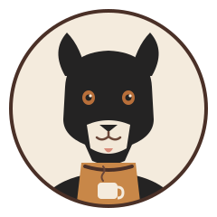
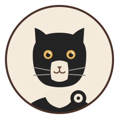

# Coffee Shop Vocabulary

The words Coffee Shop uses, and the ones it has retired. Coffee and snack metaphors name product
concepts; technical terms such as **Pi**, **Git worktree**, **status**, **log** and **report** keep
their ordinary meanings.

## Work

| Term | Definition | Aliases to avoid |
| --- | --- | --- |
| **Order** | The outcome a developer asks Coffee Shop to deliver, expressed in natural language to the Barista. | Request, ticket (unless referring to an external issue) |
| **Barista** | The active Pi session that interprets an Order, decides the Shots, and reviews returned work. | Coordinator agent, first mate |
| **Shot** | One unit of work with one prompt, run in one Station. | Job, subtask, lane |
| **Station** | The agent session for one Shot: an Odin child process that runs the agent in an isolated Git worktree. | Pane, tab, workspace (all retired) |
| **Cupping** | A read-only research Shot. Its tools are `read,grep,find,ls,write,codemode`, so it can write scratch files but must leave the source as it found it; a changed Station is reported `incomplete`. | Research (for this Shot kind) |
| **Pull** | An execution Shot that runs a **Taste** and, if it passes, commits its change on its own branch. | Task, merge |
| **Taste** | The verification a Pull runs before it commits. A Taste that cannot run or exits non-zero reports `taste_failed` and commits nothing. | Test-before-commit, check |
| **Dispatch** | The request that starts work: one JSON line naming the Beans and its Shots, with each Shot's prompt and optional `model`, `thinking`, `kind`, `taste`, `message`, `codemode`. | Recipe (retired file format) |
| **Slot** | One of five concurrent Stations a host runs. Shots beyond that queue. The budget is also machine-wide. | Scale, Worker |

## Reports and controls

| Term | Definition | Aliases to avoid |
| --- | --- | --- |
| **Report** | One line a Station sends the host over the activity socket: `turn_done`, `usage`, `needs_input`, `agent_exited`, or an outcome such as `pulled`, `taste_passed`, `taste_failed`, `incomplete`, `session_failed`. | Event (for a Station's report) |
| **Event** | One JSON line the host writes to stdout: `ready`, `received`, `dispatch_accepted`, `session_started`, `station_report`, `dispatch_queued`, `needs_input_alert`, `stale_warning`, `cancelled`, `blended`, `blend_failed`, `error`, `stopped`. | Report (for a host event) |
| **History** | `<state>/host/<request>/history.ndjson`: every event the host emitted for that request, which is what `status --stations` reads. | Log |
| **Log** | `<state>/host/<request>/logs/<shot>.log`: a Station's own output, bounded and rotated once. | History |
| **needs_input_alert** | The host's event when a Station asks a question. It names the Station and the session key a reply must use. | Notification |
| **stale_warning** | The host's event after ten minutes without a report. A warning, never a cancel. | Timeout |
| **Seam** | A CLI subcommand the host drives: `prepare` (worktree), `release` (remove worktree), `blend`, `station`. | Plugin, adapter |

## Results

| Term | Definition | Aliases to avoid |
| --- | --- | --- |
| **Blend** | An explicit operation that combines 2 to 20 Pull commits into one commit on a new branch, in a temporary worktree, then removes the worktree and keeps the branch. A conflict removes both. It never pushes. | Merge, squash, publish |
| **pr** | The explicit command that verifies a Pull from history, fast-forwards the developer's branch, pushes it, and opens a PR with `gh`. | Publish, release |
| **cleanup** | The explicit command that removes one run's worktrees and keeps every branch. | Garbage collection |

## Software concept matches

| Coffee-shop term | Software concept | Fit |
| --- | --- | --- |
| **Beans** | The target repository and the context a Station needs to work on it. | Good input metaphor; keep "repository" in technical interfaces. |
| **Menu** | Coffee Shop's CLI commands and supported options. | Good user-interface metaphor. |
| **Machine** | The Pi runtime that runs a Station's agent. | Clear in prose; use "Pi" in implementation details. |
| **Taste-Driven Development** | The skill a test-authoring Shot loads, deriving tests from the Order and the Beans' `standards.md` using the repository's own conventions. | A skill name; it changes no test command. |
| **Timer** | A deadline inside a Station: a turn that gets no reply is stopped and reported `incomplete`. | Direct mapping. |

## Relationships

- A **Brew** is retired; an **Order** is now just what the developer told the Barista, and it becomes a **Dispatch** with one or more **Shots**.
- Each **Shot** runs in one **Station**, which owns one Git worktree and one agent process.
- A **Cupping** Shot reports its findings and changes nothing. A **Pull** runs its **Taste** and commits only if it passes.
- The **Barista** reads the host's **events** (or `status`, `log`, `reply`), answers questions with `coffee-shop reply`, and reports the outcome to the developer.
- After review, **pr** opens the pull request, **Blend** combines a multi-Pull run first, and **cleanup** removes a finished run's worktrees. Coffee Shop never merges or publishes on its own.

## A Shot's life

| State | Meaning |
| --- | --- |
| **queued** | Waiting for a Slot; the host emitted `dispatch_queued`. |
| **running** | The host emitted `session_started` and the Station has not reported a terminal outcome. |
| **needs_input** | The Station asked a question and is waiting for a reply. |
| **released** | A terminal report (`pulled`, `taste_failed`, `incomplete`, `session_failed`) or process exit freed the Slot. |

A released Station can neither warn nor alert again; its worktree and branch stay until `pr` or
`cleanup` removes them.

## Characters

Each role has a character in the shared mascot style. Coffee, Oreo and Rachel are family members.

| Role | Character | Drawn as |
| --- | --- | --- |
| **Barista** | Coffee | a black German Shepherd and Golden Retriever mix with floppy ears and a charcoal muzzle, in a coffee-brown apron |
| **Reviewer** | Oreo | a black-and-white American Shorthair holding an Oreo cookie |
| **Developer companion** | Rachel | a university student with round glasses, a laptop, and a cat-paw remembrance pin |

  
  
  

The Worker, Cupper and Filter drawings stay in `assets/characters/` as the retired roles' artwork.

## Example dialogue

> **Developer:** "Order: fix the flaky login test and explain the cause."
>
> **Barista:** "I'll dispatch two Shots: one Cups the test history, one makes the fix."
>
> **Developer:** "Run them in parallel."
>
> **Barista:** "Each Shot has its own Station and worktree. I'll report what each one found, and
> the Pull will commit only after its Taste passes."

## Coffee-shop word bank

Candidate words for future product vocabulary. These are a naming palette, not additional software
concepts; only terms defined above have a Coffee Shop meaning.

- **Drinks:** espresso, ristretto, lungo, americano, cappuccino, latte, flat white, mocha, macchiato, cortado, cold brew, drip coffee, pour-over, tea, chai, matcha, hot chocolate.
- **Ingredients:** coffee beans, grounds, roast, water, milk, oat milk, cream, foam, sugar, syrup, cocoa, cinnamon, ice.
- **Brewing equipment:** espresso machine, grinder, portafilter, tamper, kettle, dripper, coffee maker, French press, filter, scale, milk pitcher, thermometer, knock box.
- **Serveware:** cup, mug, saucer, takeaway cup, lid, sleeve, straw, spoon, stirrer, tray, napkin.
- **Food:** pastry, croissant, muffin, scone, cookie, cake, toast, sandwich.
- **Shop fixtures and tools:** counter, menu, menu board, table, chair, stool, till, card reader, receipt, tip jar, display case, water jug, condiment station.

## Retired terms

These described the one-shot `brew` pipeline, which was removed in #172, and the Herdr pane layer,
removed in #174. They appear in `PLAN.md`'s historical sections and in old code names, so they are
listed here to be recognised, not used.

| Retired | Meant | Today |
| --- | --- | --- |
| **Recipe** | A JSON file describing an Order and its Shots. | A Dispatch request carries the Shots directly. |
| **Brew** | One execution of a Recipe, with a supervisor and tabs. | A Dispatch request; the host keeps its history. |
| **Worker** | A non-interactive Pi process run per Shot. | A Station, which is interactive. |
| **Filter** | An advisory review run after a Brew. | A review Shot, if the Barista asks for one. |
| **Tray** | A review packet assembled per Brew. | The Barista's own summary. |
| **Register / Receipt** | Durable Brew state and its event history. | `history.ndjson` per request. |
| **Scale** | The concurrent-Worker limit. | Slots: five per host, bounded machine-wide. |
| **Pane / tab / workspace** | Herdr's presentation layer. | A Station is a headless process. |

## Flagged ambiguities

- **Shot** is the unit of work; **Station** is the process that runs it. Do not use them interchangeably.
- **Report** comes from a Station; **event** comes from the host. The activity socket carries reports, stdout carries events.
- **Taste** is a Pull's own check before its commit. A review Shot is separate work; do not treat one as the other.
- **Cupping** must not change the source. Scratch files under `.scratch/` are allowed; anything else makes the Shot `incomplete`.
- **Blend** never pushes and is never needed for a single Pull.
- The word bank is a candidate palette only; do not assign software meanings to these words without a concrete concept that needs naming.
